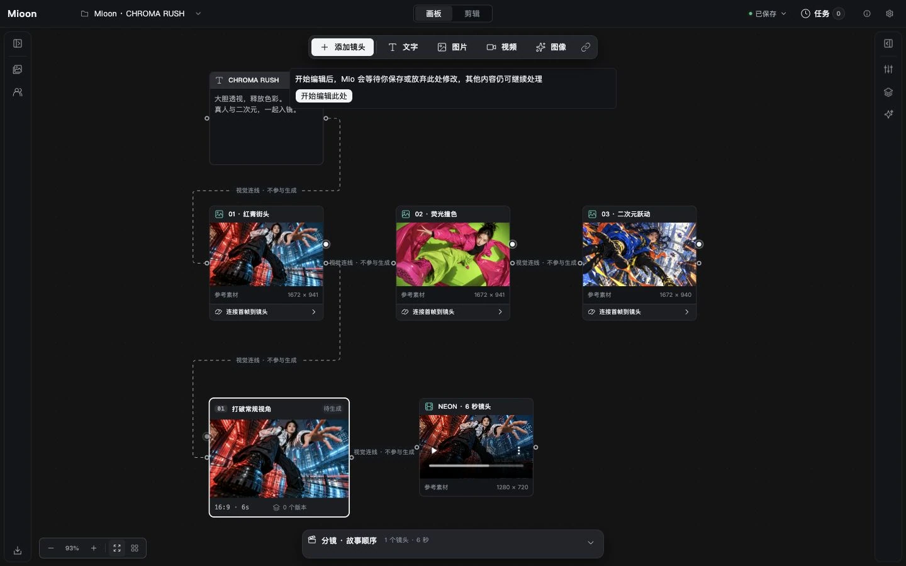
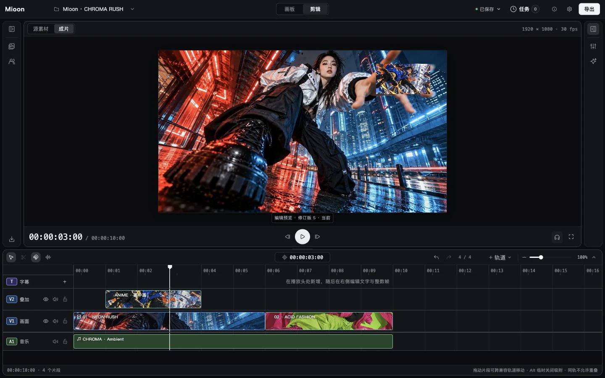
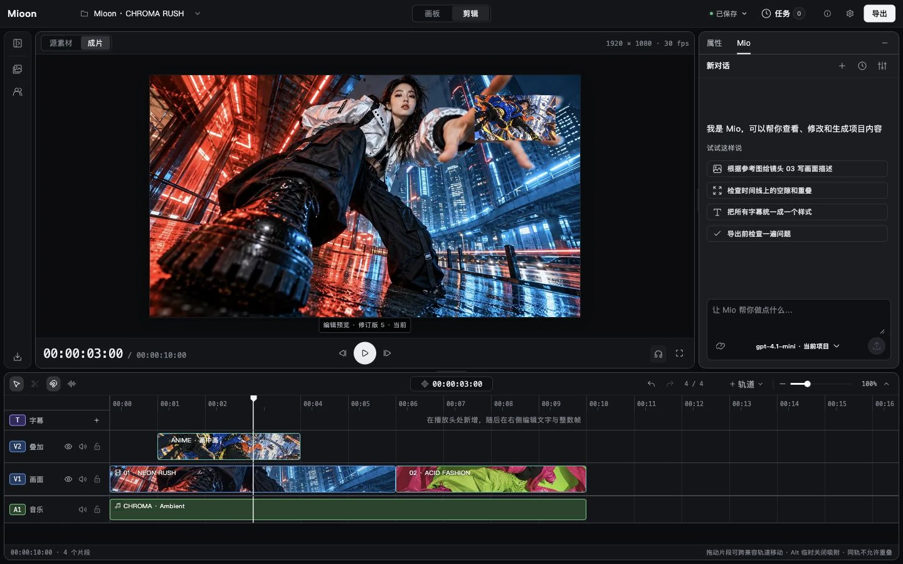

  

<h1 align="center">Mioon</h1>

<strong>从整理灵感到剪辑成片，在自己的电脑上完成</strong>

  <a href="https://mioon.app">官网</a> ·
  <a href="#mioon-能帮你做什么">功能介绍</a> ·
  <a href="#开始试用">开始试用</a> ·
  <a href="docs/WORKSPACE-GUIDE.zh-CN.md">使用指南</a> ·
  <a href="https://github.com/starroyhq/mioon/issues">问题反馈</a>

  
  
  

## Mioon 是什么

Mioon 是一个本地视频创作工作台：用画板整理灵感，在多轨时间线上编排素材，预览并导出成片。构思、剪辑和可选的 AI 辅助围绕同一个项目进行。

项目和素材默认保存在自己的电脑上。导入、剪辑、手动字幕、预览和导出已有素材，不需要 AI 账号或密钥。

## Mioon 能帮你做什么

### 用画板整理故事

把参考图片、视频、文字和镜头卡摆在画板上，为场景记下画面、顺序和想法。画板适合构思，剪辑区适合做成片，可以在同一个项目中随时切换。

### 在时间线上剪辑、预览与导出

调整片段的顺序和长短，叠放画面，配上音乐和手动字幕，再调节声音大小。操作失误时，可以撤销后重新尝试；通过合成预览检查画面与声音，确认后导出 MP4。

新项目可以选择横屏、竖屏或方形画幅。导出进度保留在任务中，关闭导出窗口后，已经开始的任务仍会继续。

### 需要时，让 Mio 搭把手

Mio 是可选的项目助手，在你的授权下查看、修改和生成当前项目内容。模型连接和执行方式由你配置，工具执行保留记录，待确认的操作可在原任务中继续处理。

图片和视频生成需要自行配置供应商及凭据，按界面核对本次输入与费用确认。生成的镜头会作为新版本保留，已经放进剪辑区的片段不会因为新一轮生成而自动替换。

以上为[官网演示项目截图](docs/images/readme/SOURCES.md)；导入素材不代表 Mioon 生成结果。

可选模型连接及能力范围：

- [视频服务](docs/PROVIDERS.md)：火山方舟、Google Veo、MiniMax、Vidu、可灵、通义万相及自定义兼容连接。
- [图片生成](docs/IMAGE-ACTIVATION.md)与[图片编辑](docs/IMAGE-EDITING.md)：OpenAI 官方、自定义兼容连接及 ComfyUI 的范围见对应说明。
- Mio 支持 Chat Completions、Responses 和 [Anthropic Messages](docs/AGENT-ANTHROPIC.md)，由你明确选择协议，不自动重试或回退到其他协议。

界面支持深色、浅色和跟随系统主题，以及简体中文、繁体中文、英语和日语。

## 开始试用

**Mioon 目前处于源码试用阶段，需要手动准备运行环境，还没有经过验证的现成安装包**。首次启动请按[试用指南](docs/CORE-TRIAL.zh-CN.md)操作；Mac 用户可查看 [Mac 启动说明](docs/MAC-SOURCE-TRIAL.zh-CN.md)

应用启动后，可以先试着做一段简单的视频：

1. **新建项目**：选好竖屏、横屏或方形画面
2. **导入素材**：加入几张图片、一段视频或一段音乐
3. **开始剪辑**：把素材加入剪辑区，排好顺序，调整长短并更新预览
4. **导出成片**：检查设置，等待完成，再打开导出的视频看看

每一步的详细操作见[工作区使用指南](docs/WORKSPACE-GUIDE.zh-CN.md)，也可以使用仓库提供的[本地示例素材](examples/README.md)练习

## 使用前了解这几件事

- **素材默认保存在本机**：导入素材不会自动上传。使用外部 AI 功能时，相关提示词或素材会发送给你配置的服务，并可能产生费用
- **记得备份项目**：当前没有自动云同步，重要项目请按[备份指南](docs/WORKSPACE-BACKUP-GUIDE.zh-CN.md)保存副本
- **先从短片开始**：当前适合轻量剪辑，复杂转场、变速和多人协作等功能尚未提供
- **仍在试用阶段**：Windows 目前暂不支持使用，macOS 和 Linux 的进展见[版本状态](docs/verification/mioon-redesign/STATUS.md)。问题与验证限制持续记录在 [Issues](https://github.com/starroyhq/mioon/issues) 中，遇到问题欢迎反馈

## 更多说明

- [第一次试用](docs/CORE-TRIAL.zh-CN.md) · [完整使用指南](docs/WORKSPACE-GUIDE.zh-CN.md)
- [连接 AI 视频服务](docs/PROVIDERS.md) · [生成图片](docs/IMAGE-ACTIVATION.md) · [编辑图片](docs/IMAGE-EDITING.md)
- [导出设置](docs/EXPORT-SETTINGS.md) · [备份与恢复](docs/WORKSPACE-BACKUP-GUIDE.zh-CN.md)
- [反馈问题与建议](https://github.com/starroyhq/mioon/issues)
- [参与贡献](CONTRIBUTING.md) · [安全问题报告](SECURITY.md)

## 许可证

Mioon 原创代码与文档采用 [Apache License 2.0](LICENSE)，允许按许可证条款使用、修改和分发。版权与归属声明见 [NOTICE](NOTICE)。

第三方依赖、组件、图标及字体保留各自许可，详情见 [第三方声明](THIRD_PARTY_NOTICES.md)。用户素材及模型服务输出的权利由对应来源决定。

开发者与进阶用户

- [本地运行与检查](docs/PORTABLE-TOOLING.md) · [桌面运行说明](docs/DESKTOP.md)
- [GitHub 自动检查与发布](docs/GITHUB-ACTIONS.zh-CN.md) · [CI 状态](https://github.com/starroyhq/mioon/actions/workflows/ci.yml)
- [CLI](docs/CLI.md) · [MCP](docs/MCP.md) · [mioon Skill](skills/mioon/SKILL.md) · [API](docs/API.md)
- [架构说明](docs/ARCHITECTURE.md) · [组件来源](docs/UI-COMPONENTS.md) · [TypeScript 约定](docs/TYPESCRIPT.md)
- [详细验证结果](docs/verification/mioon-redesign/full-test-repairs/README.md)

