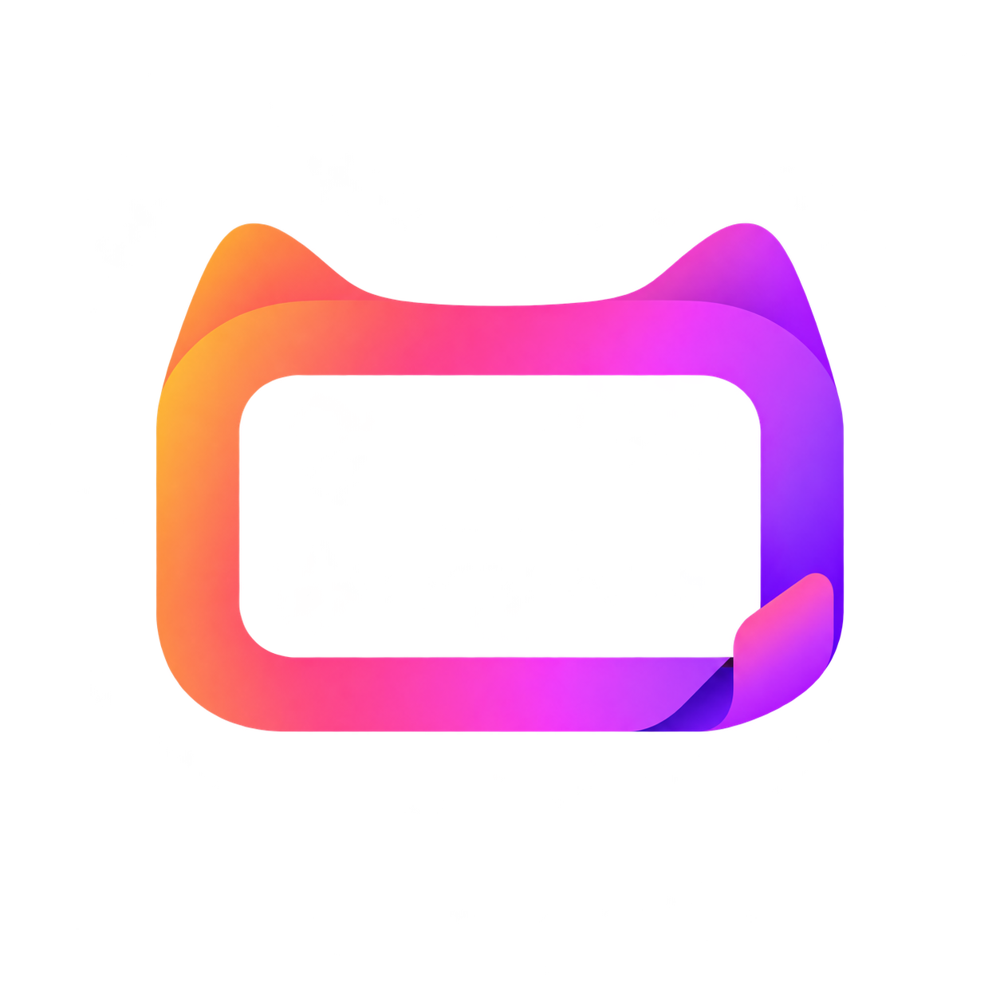
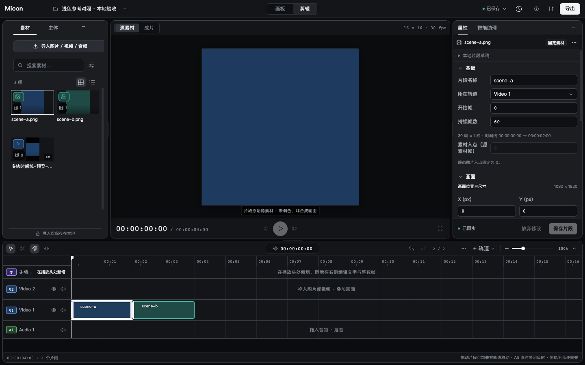
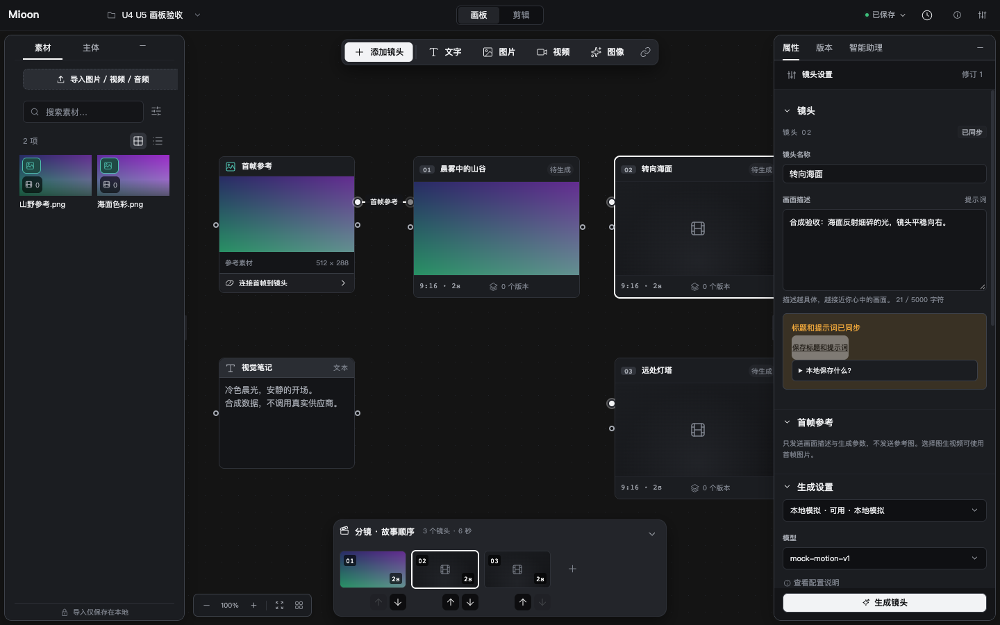

  

<h1 align="center">Mioon</h1>

<strong>从整理灵感到剪辑成片，在自己的电脑上完成</strong>

  <a href="#mioon-能帮你做什么">功能介绍</a> ·
  <a href="#开始试用">开始试用</a> ·
  <a href="docs/WORKSPACE-GUIDE.zh-CN.md">使用指南</a> ·
  <a href="https://github.com/starroyhq/mioon/issues">问题反馈</a>

  
  

## Mioon 是什么

Mioon 是一个个人视频创作工具。你可以先用画板整理想法，再把图片、视频和声音放到剪辑区，组合成一段完整的视频

从整理素材、构思镜头到导出成片，都可以围绕同一个项目进行。项目保存在自己的电脑上，导入、剪辑和导出已有素材不需要 AI 账号或密钥

## Mioon 能帮你做什么

### 先把想法摆出来

把参考图片、视频和文字放到画板上，为每个镜头记下画面、顺序和想法。先看清楚要讲什么，再开始剪辑

画板适合构思，剪辑区适合做成片，随时切换就能继续工作

### 把零散素材剪成一个故事

调整片段的顺序和长短，叠放画面，配上音乐和字幕，再调节声音大小。操作失误时，可以撤销后重新尝试

点击“渲染预览”或“更新预览”，就能查看合成后的画面与声音，确认效果再导出

### 多试几个版本，再决定用哪一个

使用生成镜头功能时，新结果会作为新版本保留，你可以比较后再选。已经放进剪辑区的片段会保持原样，不会因为换了镜头版本而跟着变化

AI 视频服务可以在“设置 → 模型服务”中配置供应商连接、密钥和模型目录，支持火山方舟、Google Veo、MiniMax、Vidu、可灵及通义万相。调用可能产生费用，目前真实服务仍待独立验证。第一次试用可以先用自己的素材完成一段视频

通义万相通过官方 SDK 接入，保留 Wan 2.7，并提供 Wan 3.0 标准版和高速版。Wan 3.0 支持文本、本地首帧、首尾帧和最多 10 张参考图；可用参数随所选模型开放，图片通过 Base64 发送。需要公网地址的音视频、文档和网页输入暂未接入，具体限制见[视频供应商说明](docs/PROVIDERS.md)

### 导出适合分享的视频

新项目开始剪辑前，可以选择竖屏、横屏或方形画面。完成剪辑后，按步骤检查并导出 MP4，也可以选择更小的尺寸，方便预览和分享

导出进度可以在任务中查看，关掉导出窗口后，已经开始的任务仍会继续

### 按自己的习惯使用

在首页找到最近的项目，修改名称，继续上次的创作。界面提供深色、浅色和跟随系统主题，也支持简体中文、繁体中文、英语和日语

内置 AI 助手名为 Mio，可按授权查看、修改和生成当前项目内容。模型连接和执行方式在“设置 → Mio”中配置，模型调用可能计费

Mio 支持 Chat Completions、Responses 和通过官方 SDK 接入的 [Anthropic Messages](docs/AGENT-ANTHROPIC.md)。协议需明确选择，工具执行仍由 Mioon 管理授权、审批和恢复，不自动重试或回退到其他协议

## 开始试用

**Mioon 目前处于源码试用阶段，需要手动准备运行环境，还没有经过验证的现成安装包**。首次启动请按[试用指南](docs/CORE-TRIAL.zh-CN.md)操作；Mac 用户可查看 [Mac 启动说明](docs/MAC-SOURCE-TRIAL.zh-CN.md)

应用启动后，可以先试着做一段简单的视频：

1. **新建项目**：选好竖屏、横屏或方形画面
2. **导入素材**：加入几张图片、一段视频或一段音乐
3. **开始剪辑**：把素材加入剪辑区，排好顺序，调整长短并更新预览
4. **导出成片**：检查设置，等待完成，再打开导出的视频看看

每一步的详细操作见[工作区使用指南](docs/WORKSPACE-GUIDE.zh-CN.md)，也可以使用仓库提供的[本地示例素材](examples/README.md)练习

## 使用前了解这几件事

- **素材默认保存在本机**：导入素材不会自动上传。使用外部 AI 功能时，相关提示词或素材会发送给你配置的服务，并可能产生费用
- **记得备份项目**：当前没有自动云同步，重要项目请按[备份指南](docs/WORKSPACE-BACKUP-GUIDE.zh-CN.md)保存副本
- **先从短片开始**：当前适合轻量剪辑，复杂转场、变速和多人协作等功能尚未提供
- **仍在试用阶段**：Windows 目前暂不支持使用，macOS 和 Linux 的进展见[版本状态](docs/verification/mioon-redesign/STATUS.md)。当前还有一些[已知问题](https://github.com/starroyhq/mioon/issues/5)待解决，遇到问题欢迎反馈

## 更多说明

- [第一次试用](docs/CORE-TRIAL.zh-CN.md) · [完整使用指南](docs/WORKSPACE-GUIDE.zh-CN.md)
- [连接 AI 视频服务](docs/PROVIDERS.md) · [生成图片](docs/IMAGE-ACTIVATION.md) · [编辑图片](docs/IMAGE-EDITING.md)
- [导出设置](docs/EXPORT-SETTINGS.md) · [备份与恢复](docs/WORKSPACE-BACKUP-GUIDE.zh-CN.md)
- [反馈问题与建议](https://github.com/starroyhq/mioon/issues)

开发者与进阶用户

- [本地运行与检查](docs/PORTABLE-TOOLING.md) · [桌面运行说明](docs/DESKTOP.md)
- [GitHub 自动检查与发布](docs/GITHUB-ACTIONS.zh-CN.md) · [CI 状态](https://github.com/starroyhq/mioon/actions/workflows/ci.yml)
- [CLI](docs/CLI.md) · [MCP](docs/MCP.md) · [mioon Skill](skills/mioon/SKILL.md) · [API](docs/API.md)
- [架构说明](docs/ARCHITECTURE.md) · [组件来源](docs/UI-COMPONENTS.md) · [TypeScript 约定](docs/TYPESCRIPT.md)
- [详细验证结果](docs/verification/mioon-redesign/full-test-repairs/README.md)

