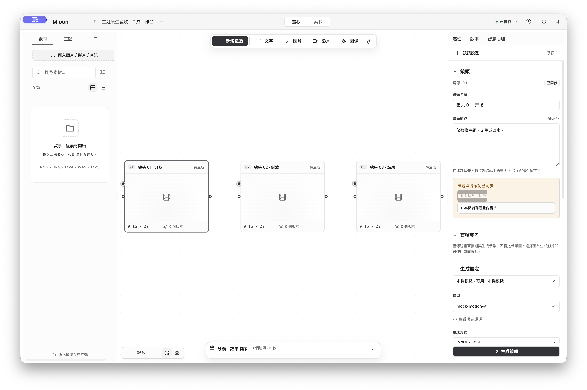

# 正式主题 · macOS 原生验收

2026-10-19。**7 项实机检查通过；最终截图有系统共享指示遮挡交通灯的明确限制。** 本轮没有修改应用源码。

## 实际结果

通过 CUA 操作真实原生设置页的主题下拉框与“保存”，在同一份私有合成数据上验证：

| 操作 | 实际结果 | 证据 |
| --- | --- | --- |
| 新构建重新启动 | 已存 light 恢复 | [01](final-01-persisted-light.json) |
| 预览 dark 草稿 | 仅设置页预览；其他窗口及原生背景仍保留已存 light | [02](final-02-dark-draft.json) |
| 保存 dark，revision 5 | 设置、编辑器、隐藏首页均自动 dark；原生背景均为 `#0B0C0E` | [03](final-03-dark-saved-all-windows.json) |
| 保存 light，revision 6 | 三窗均自动 light；原生背景均为 `#F6F6F6` | [04](final-04-light-saved-all-windows.json) |
| 保存 system，revision 7 | 三窗 requested 均为 system；按当前真实 OS 浅色解析为 light | [05](final-05-system-saved-all-windows.json) |
| 保存 light，revision 8 | 三窗再次自动一致 | [06](final-06-light-restored-all-windows.json) |
| 关闭设置返回编辑器 | 编辑器保持浅色，未重载 | [07](final-07-editor-after-settings-close.json) |

保存与跨窗补验期间**没有执行 reload**。`nativeTheme.themeSource` 始终为 `system`，没有用固定 dark/light 污染系统查询。原生 `getWindowButtonPosition()` 在各窗均为 `{x:20,y:22}`。

初轮发现的“独立设置已保存，但已开工作台仍旧主题”有 [修复前证据](../before-window-sync/02-light-saved.json)。本轮新构建的逐窗实测已经验证修复；两个阶段的输入 hash 分开固定。

## 原生系统帧

[最终构建原图](light-native-system-frame.png) 由 screenshot 技能的 `take_screenshot.py --window-id 78321` 调用 macOS `screencapture -l` 生成，未编辑、未合成。图中浅色画布、节点、素材库和属性区已目视核对。

本图的交通灯区域被 macOS 紫色共享指示覆盖，**不将它声明为最终构建红黄绿颜色无遮挡的证据**。前阶段确有 [红黄绿无遮挡原图](../before-window-sync/light-native-system-frame.png)，但它对应 [前阶段构建](../before-window-sync/build-inputs.json)，不会冒充本轮构建。两图 SHA256 及尺寸均在 [results.json](results.json)。

窗口 CG bounds 为 `278,121,1500,960` 逻辑点，2× backing 的窗口主体为 `3000×1920` 像素；PNG `3224×2144` 包含原生阴影，不能把它当作窗口 bounds。除系统指示外未见顶部导航与原生控制预留区相互遮挡。

## 输入、观测方式与清理

运行 `/private/tmp/mioon-light-v3-uf1kv1gy/verify/apps/desktop/build` 的私有副本，启动前逐一核对 **56 个构建文件，0 hash 差异**；[固定清单](build-inputs.json)。Electron 为 `44.7.0`，应用版本 `0.4.1`，development 通道。

仅私有副本的 package.json `main` 指向 [只读观测 wrapper](observation-harness.cjs)，再 require 字节一致的原始 `main.cjs`；原始业务、后端、preload 与前端资源均未修改。wrapper 通过 Electron 真实 `BrowserWindow.getBackgroundColor()`、bounds、交通灯 API，以及固定只读 DOM 投影记录状态，不注入 UI 写操作、不增加 IPC 或调试端口。实际 UI 选择与保存由 CUA 完成。没有凭据配置、生成或真实供应商调用。

最终 PID `87332` 经 SIGTERM 进入现有 `app.quit()` 正常退出，**归属的 6 个进程全部退出**。本轮独占的 `/private/tmp/mioon-appearance-native-vhsh3ayd`（含 runtime、userdata）已清理；前轮 PID `44488` 的 6 个进程亦已退出。用户真实数据和其他进程未操作。

## 覆盖边界

- 真实 OS 本轮始终为浅色；没有改变用户全局 OS 外观，因此不声称实测了 OS 深浅双向切换。事件、旧回调和上下文边界由专属测试覆盖。
- 未添加单独的 ReactFlow DOM class 探针；本项包含实际浅色画布目视证据，前端行为测试与浏览器矩阵另由根代理整合。
- 本次是独立 UI/native API 走查，没有重跑全部 22 项旧 native smoke，也不把它计为本轮通过；未扩展到打包、发布或其它平台。
- 专属 helper **8/8**、原窗口生命周期 **43/43**，独立 TAP 与 JSON 见 [tests/manifest](../tests/manifest.json)；归并时按文件名去重。对应隔离 typecheck 退出 0。

原始证据的文本凭据模式扫描为 0；宽松模式中 3 个 `rk-` 命中来自 `dark-*` 检查名称，已明确分类为误报。
