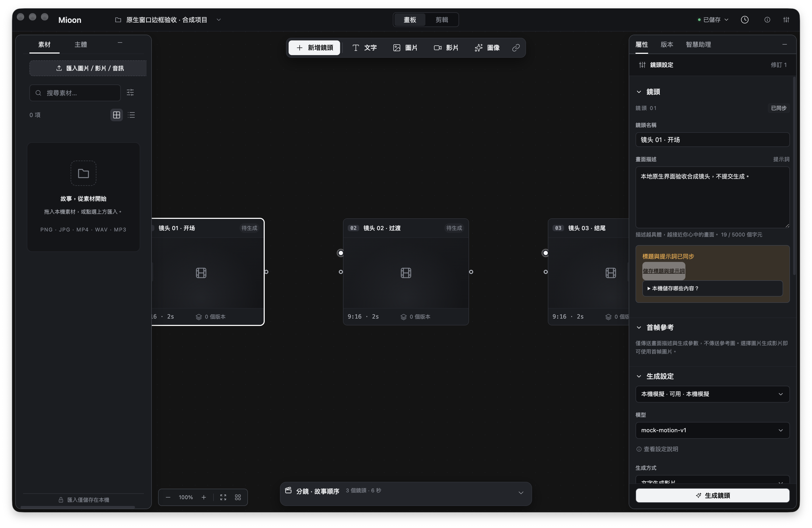

# macOS 原生系统窗口边框验收

2026-10-19，使用最终开发构建、独立私有数据目录与合成项目，补齐系统窗口层面的截图证据。未修改应用源码或共享验收报告。

## 实测结果

- **通过，有范围限制**：真实 macOS 窗口截图包含圆角边框、阴影、三个灰色原生交通灯，以及已加载的工作台。合成项目的三个持久镜头、素材库、属性和顶部导航均可见。
- 主图：[native-workbench-system-frame.png](native-workbench-system-frame.png)。由截图技能的 `take_screenshot.py --window-id 77543` 调用系统 `screencapture -l` 取得，保留原始 PNG；未用 `webContents.capturePage`，未合成或重绘系统控件。
- CGWindow 实测 bounds：`x=278, y=121, width=1500, height=960` **逻辑点**；2× backing 对应窗口主体 **3000×1920 像素**。主 PNG **3092×2012 像素**包含系统阴影，不能把 PNG 总尺寸当成窗口尺寸。
- 三个交通灯在主 PNG 内的可见圆形包围框分别为 `[64,50,92,78]`、`[110,50,138,78]`、`[156,50,184,78]` 像素。Mioon 文字约从 `x=222px` 开始，右侧交通灯与标识间留白约 **38px / 19pt**。目视未见交通灯遮挡标识、项目选择或模式切换。

## 构建与操作归属

启动前逐一核对 [本次固定构建清单](build-inputs.json) 的 **61 个文件**，hash 全部一致。使用 worktree 的 `apps/desktop/build`，Electron `44.7.0` 开发宿主；版本 `0.4.1`，身份 `app.starroy.mioon.dev / Mioon Dev`。其后根代理重新构建了未启用的浅色 CSS 候选 v2；本次证据准确对应前轮 61 文件清单，原生宿主和后端未变化。

先运行 screenshot 技能的 macOS permissions preflight，退出码 0，结果为屏幕录制权限已授予。私有目录由本次验收创建（0700），原生宿主仅指向该目录。通过该实例的本地 API 建立一个合成项目与三个镜头，再从原生 UI 打开。未配置凭据、未提交生成、未调用真实供应商。

## 覆盖限制

主图显示的是**非激活灰色交通灯**，本项未验证激活红黄绿颜色或关闭/最小化/缩放点击行为。自动化选中、激活窗口时，控制区会出现紫色系统共享指示；[次图](native-workbench-automation-indicator.png) 如实保留该状态，**不用于判定交通灯通过**。

截图只证明可见位置和留白，不独立证明 Electron `getWindowButtonPosition()` 的 `{x:20,y:22}` API 值；该值已有 [原生 smoke 报告](../native/report.json) 的独立证据。本轮只补 macOS 开发构建系统边框，未扩展到打包发布、Linux 或 Windows。

## 清理

向本次启动的 PID `42518` 发送 SIGTERM，由宿主现有 `app.quit()` 正常退出；核查本实例归属的 **6 个进程全部退出**，后端 PID `42590` 也已退出。仅删除本次创建的 `/private/tmp/mioon-native-system-frame-mkcdexrt` 数据树，确认目录已不存在。未操作真实项目、其他应用进程或用户设置。

逐图 SHA256、窗口元数据、构建清单 hash 与清理结果见 [results.json](results.json)。
